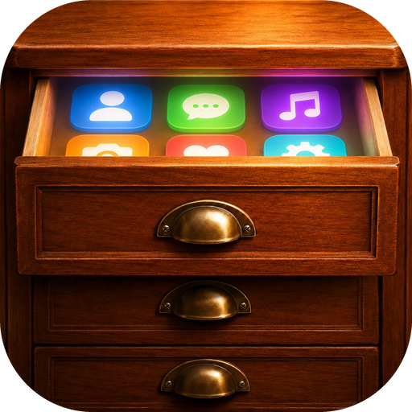

#  Top Drawer

> [!IMPORTANT]
> LLM disclosure: This codebase was written with substantial help from large language models: AI coding agents working from the [`AGENTS.md`](AGENTS.md) brief in this repo.

Screen-edge tabs that open drawers of your apps, files, folders, and links. Inspired by the classic **[DragThing](https://www.dragthing.com/)**. *(Formerly known as MacDring.)*

**Latest release:** v<!-- version -->2.4.0<!-- /version --> · [Download](https://github.com/L-K-M/TopDrawer/releases/latest)

The build is ad-hoc signed and not notarized. After moving **Top Drawer** to
Applications, run:

```bash
xattr -dr com.apple.quarantine "/Applications/Top Drawer.app"
```


Tabs sit against the edges of your screens. Click one and a
drawer slides out with whatever you put there. Drag files onto a tab to add them.
Works across multiple monitors, and your tabs return to exactly where you left
them after a restart.

Top Drawer is English-only. Tabs stay anchored to screen edges; free-floating
docks are not planned.

> [!IMPORTANT]
> LLM Disclosure: Top Drawer was built with substantial help from large language models — primarily Anthropic's Claude, via Claude Code. Much of the code arrived through AI-authored commits and `claude/*` pull-request branches, with agent guidance kept in [`AGENTS.md`](AGENTS.md)

If you like this, also look at **[Zap](https://github.com/L-K-M/Zap)** (a ⌘-Tab
switcher) and **[Jetty](https://github.com/L-K-M/Jetty)** (a Dock replacement). Set an
app's icon once in **[Pict](https://github.com/L-K-M/Pict)** and Top Drawer, Zap, and
Jetty all draw it.

## Features

- **Edge tabs → drawers.** Colored tabs anchored to any screen edge; click (or
  hover) to open a drawer.
- **Resizable notes drawers.** Drag an exposed edge or corner to resize your
  scratchpad. Each notes tab remembers its size across restarts.
- **Nine tab types** — an **items** tab (apps, files, folders, links arranged freely
  in a grid with gaps), a **notes** tab (a live Markdown scratchpad: type formatted
  text, tick off task items, and show the formatting bar from the drawer header
  when you want the buttons), a **folder**
  tab (a live, read-only view of a directory's contents), a **disks** tab (your mounted
  ejectable volumes), a **network** tab (your mounted network shares), a **cloud** tab
  (your cloud drives — iCloud, Dropbox, …), a **recents** tab (what you've recently
  opened — from Top Drawer, the whole Mac via Spotlight, or both), a **fresh** tab
  (files that just arrived — downloads, copies, saves), and a **clipboard** tab
  (your last 50 distinct text copies, kept in memory; click to copy again). See the
  docs for the [network & cloud](docs/network-and-cloud-drives.md),
  [recents & fresh](docs/recents-and-fresh.md), and
  [clipboard history](docs/clipboard-history.md) tabs.
- **Holds anything launchable** — applications, files, folders, and URLs. One
  click opens them.
- **Drag-and-drop to add.** Drop files or apps from Finder — or a link dragged from
  a browser's address bar — onto a tab or its open drawer.
- **Spring-loaded drops.** Drag a file onto a tab and its drawer springs open; the
  slot under your cursor **highlights**, and dropping there files the item into that
  slot — onto an app to open it with, onto a folder to move it in.
- **Type to find.** With a drawer open, just start typing to filter it; **↑/↓** move
  the selection, **Return** opens it, **Esc** clears (then closes). Shown on drawers
  with a handful of items or more.
- **Keyboard navigation and previews.** Arrow through an unfiltered grid or list;
  **Return** opens the selection and **Space** shows Quick Look for a selected
  file or folder. **⌘[ / ⌘]** switch tabs on the same screen edge. Optional
  scroll/swipe switching over tab pills is in **Settings → General**.
- **File and website actions.** Right-click for **Quick Look**, **Browse Folder**,
  **Open With**, or **Preview Website**. Per-tab settings can make folder pop-ups
  or website previews the default click action; Finder/browser remain the defaults.
- **Item locks and visual presets.** Protect individual launcher entries, lock all
  items, or lock new items by default. Per-tab appearance includes Glass, Flat,
  and High Contrast presets, title visibility, typography, and file extensions.
  See [drawer interactions](docs/drawer-interactions.md).
- **Trash item.** Add a Trash to any tab (Settings → Tabs → *Add Trash*): click it to
  open the Trash, or drop files onto it to throw them away.
- **Running-app dot.** Application items show a small green dot when the app is
  running, updating live as apps launch and quit.
- **Per-tab color, name, and glyph** (SF Symbol or letters).
- **Shared app icons.** With **[Pict](https://github.com/L-K-M/Pict)** installed,
  right-click an app → *Change …'s Icon Everywhere…* sets that app's icon once and
  [Zap](https://github.com/L-K-M/Zap) and [Jetty](https://github.com/L-K-M/Jetty)
  draw it too. Top Drawer also shows an app's real, un-masked artwork instead of
  macOS 26's grey squircle plate.
- **Custom item icons.** Right-click any item → *Customize Icon…* to give it a
  colored **folder** or **rounded tile** with an SF Symbol burned in (or pick an
  image file). Works on every tab — see [the docs](docs/custom-icons.md).
- **Multi-monitor support.** Tabs live on a specific display + edge and
  react live to displays connecting, disconnecting, and changing resolution.
- **Stable restore.** Tabs return to the same display and spot after a restart,
  resolution change, or reconnection.
- **Optional per-tab hotkey** to toggle drawers.
- **Layout import / export.** Back up or move your whole arrangement: **Settings →
  Tabs** has export/import buttons that save the tabs-and-items document as a
  JSON file and load it back (importing replaces the current layout, after a
  confirmation).
- **Auto-hide / auto-fade tabs.** Set a tab to get out of the way when idle
  (**Settings → Tabs → When idle**): **Auto-hide** slides it off its edge leaving a
  thin sliver, **Auto-fade** dims it in place (opacity adjustable in **Settings →
  Appearance**). Reveals the moment you move the pointer to that screen edge. Turn on
  **Settings → General → Idle tabs → Reveal all hidden tabs together** to have one
  reveal bring back every hidden tab at once (and hide them together when you leave).

## Build & Run

Requires **Xcode 16+** and **macOS 14+**.

```bash
# Build
xcodebuild -project MacDring.xcodeproj -scheme MacDring -configuration Debug build

# Release build
xcodebuild -project MacDring.xcodeproj -scheme MacDring -configuration Release build

# Run unit tests
xcodebuild -project MacDring.xcodeproj -scheme MacDring -destination 'platform=macOS' test
```

For a convenient local build, `scripts/build.sh` does an incremental Release build
and reveals the app in Finder on success; `scripts/build.sh --clean` resets any
wedged Xcode build daemons and rebuilds from scratch.

For day-to-day development, open `MacDring.xcodeproj` in Xcode and run.

### Notes editors

On macOS 14+, notes use [swift-markdown-engine](https://github.com/nodes-app/swift-markdown-engine),
pinned to `0.14.0`: a native TextKit 2 editor with live Markdown styling. The
header's formatting button shows controls for emphasis, headings, lists, quotes,
and inline code. Cmd-B and Cmd-I work with the bar hidden. Cmd/Ctrl-click an
HTTP(S) link to open it in your browser. Notes remain Markdown in the existing
JSON document; opening a note does not rewrite it.

The earlier web editor remains in `EditorWeb/` with its standalone harness and
tests. It is no longer copied into the macOS app. Its raw-source mode is available
in that harness, not in the native notes drawer.

After changing anything under `EditorWeb/src/`, rebuild the bundle and commit the
result along with the source change:

```bash
cd EditorWeb && npm ci && npm run build && npm test
```

EditorWeb has its own CI job that reruns those tests, a headless-browser smoke
test of the editor and its bridge, and a check that the committed bundle matches
the sources. See `EditorWeb/README.md` for the bridge protocol and
`docs/markdown-editor-improvement-plan.md` for the editor decisions and manual checks.

### Linux (experimental)

A Linux port is in progress under [`linux/`](linux/README.md): a D-Bus daemon
(`topdrawerd`) that serves the same launcher document, volumes, Trash, recents,
launching and running-app state, and a GTK4 + layer-shell frontend
(`topdrawer-shell`) that today draws a first dock strip on compositors implementing
wlr-layer-shell (KDE Plasma 6, sway, hyprland, COSMIC); on GNOME the daemon runs but
the frontend exits by design (a Shell extension is planned). Releases attach a
`TopDrawer-<version>-amd64.deb` for Ubuntu 24.04 and newer:

```sh
sudo apt install ./TopDrawer-<version>-amd64.deb
systemctl --user enable --now topdrawerd
```

See [`linux/README.md`](linux/README.md) for what's implemented, the D-Bus interface,
and how the package is built, and [`docs/linux-port/`](docs/linux-port/README.md) for
the research and plan behind it.

## Usage

1. Launch Top Drawer — it appears as a sidebar icon in the menu bar, and a starter
   **Apps** tab appears on the right edge of your main display.
2. **Click the tab** to open its drawer; click an item to launch it.
3. **Drag files or apps** from Finder onto a tab to add them.
4. **Right-click a tab** → *Configure Tab…* to rename it, change its color/glyph,
   move it to another edge or display, set behavior, or assign a hotkey. **Right-click
   an item** in its drawer → *Customize Icon…* to give it a colored folder/tile +
   SF Symbol icon.
5. Use the menu bar → **New Items / Notes / Folder / Disks / Network / Cloud /
   Recents / Fresh / Clipboard Tab…** to add more (a small dialog sets the name, color, type, and
   folder), or **Top Drawer Settings…** to manage everything. A **Disks** tab lists your
   mounted ejectable volumes; a **Network** tab lists your mounted network shares (click
   to open, eject from the menu); a **Cloud** tab lists your cloud drives such as iCloud
   Drive and Dropbox (click to open); a **Recents** tab lists what you've recently
   opened — from Top Drawer, from the whole Mac via Spotlight, or both (Settings → Tabs →
   *Source*); a **Fresh** tab lists files that just arrived (downloads, copies, saves).
   See [network & cloud](docs/network-and-cloud-drives.md) and
   [recents & fresh](docs/recents-and-fresh.md).
6. For clipboard history on macOS, choose **New Clipboard Tab…**. Copy text in any
   app, open the drawer, click an entry to copy it, then paste with **⌘V**. Type to filter;
   **↑/↓** and **Return** select and copy. The header's trash button clears history.
   History is shared across Clipboard tabs. Enable **Settings → Tabs → Clipboard →
   Keep history after quitting** to retain it across restarts; otherwise quit clears
   it. Removing the last Clipboard tab always clears history. Images and files are
   not recorded.

### Customizing

- **Per tab** (right-click → *Configure Tab…*, or **Settings → Tabs**): name,
  color, glyph, edge, display, position, keep-open, **drawer layout (grid / list)**,
  how it idles, and an optional hotkey. **Layout** is a straight per-tab choice; the
  **list** layout is a compact, scrolling Finder-style table — small icons with
  **Date**, **Size**, and **Kind** columns (the date is Date Added for Fresh, last-used
  for Recents, modified for folders). The drawer's **Columns / Rows** size it just like
  the grid (it scrolls past what fits); a narrower drawer shows fewer of the metadata
  columns. Handy for a Fresh tab ordered by when files arrived.
  **Open-on-hover** and **close-when-you-click-elsewhere** follow the global default
  unless you override them here — pick *On* / *Off* for the tab, or *Use global default*
  to follow the global setting again (the clear way to revert).
- **Global** (**Settings → Appearance / General**): **tab style (modern/classic)**,
  drawer translucency (translucent / frosted / solid), icon size, corner radius, tab thickness,
  labels, single vs. double-click to open, the **open-on-hover / close-on-click
  defaults** (overridable per tab), animation speed, the multi-display disconnect
  policy, and launch at login.

## Permissions & Distribution

Top Drawer needs **no special permissions** for its core features — launching uses
`NSWorkspace`, and optional hotkeys use Carbon (no Accessibility grant). It ships
as a menu-bar agent (`LSUIElement`).

Optional features ask only when you choose to use them:

- **Empty Trash** asks Finder to empty the Trash via Apple Events, so the first time
  you use it macOS prompts once to allow Top Drawer to control Finder (the app carries
  the `com.apple.security.automation.apple-events` entitlement). Declining just leaves
  the Trash as-is — nothing else needs it.
- **Fresh tabs' direct folder check** (Settings → General, off by default) makes Fresh
  tabs read Downloads, Desktop, and Documents themselves, in addition to the
  permission-free Spotlight index — for Macs where Spotlight is off or unreliable.
  Turning it on makes macOS ask once per folder for access; left off, Fresh tabs stay
  Spotlight-only and never prompt.
- **Clipboard history** reads copied text while a Clipboard tab exists. On macOS
  15.4+, the system may ask for clipboard access. Its per-app clipboard setting
  controls background recording; this feature needs no Accessibility permission.
